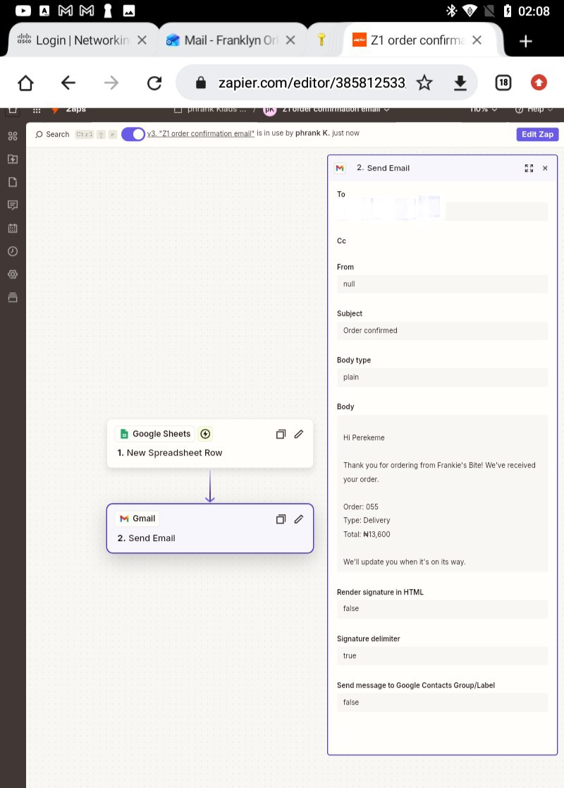

# Zap 1: Order Confirmation Email

| | |
|---|---|
| **Business** | Frankie's Bite (synthetic data), Yenagoa |
| **Tools** | Zapier, Google Sheets, Gmail |
| **Trigger** | Google Sheets, New Spreadsheet Row (`orders` tab) |
| **Action** | Gmail, Send Email |
| **Status** | Published and tested |

## The problem
Customers get no instant confirmation after ordering, so they call or message to ask if their order was received.

## The solution
When a new order row is added to the sheet, the Zap emails the customer a confirmation. The subject is `Order confirmed: [order_id]`, and the body greets the customer by name and shows the order ID, type and total in naira (₦).

Test emails went to my own address, because the sample customer emails use example.com.

## What went wrong, and how I fixed it
- **Repeated, cut-off text in the email** ("deliverydeliverydel"). I removed the duplicate and inserted each field once from the data picker.
- **Order ID showed as "0005"** instead of "ORD-00005". I mapped the `order_id` field so the full ID appears.
- **Amount used "#"**. I switched to the naira sign (₦).
- **Wrong wording** ("total amount paid", "ready for delivery"). This is misleading for a new order, so I changed it to "We've received your order" and "Your total is ₦...".
- **Subject had no order ID**. I added `[order_id]` to the subject.

## What I learned
- Test with real sample data. The first email showed mistakes I couldn't see in the editor.
- Wording must match the order stage. Saying "paid" or "ready" too early misleads customers.
- Insert fields from the data picker instead of typing them by hand.

## Next improvements
- Format the estimated time with a Formatter (Date/Time) step instead of a raw timestamp.
- Skip cancelled orders with a Filter (done in Zap 2).
- Send to the real customer email in production.
- Add an error alert if the Gmail step fails.

## Screenshots
**Zap canvas**

**Email received**

