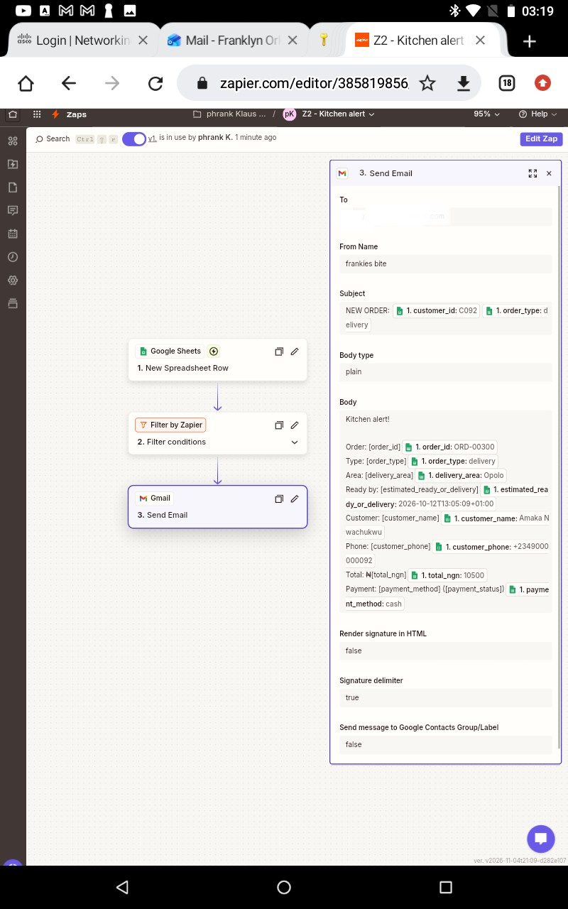
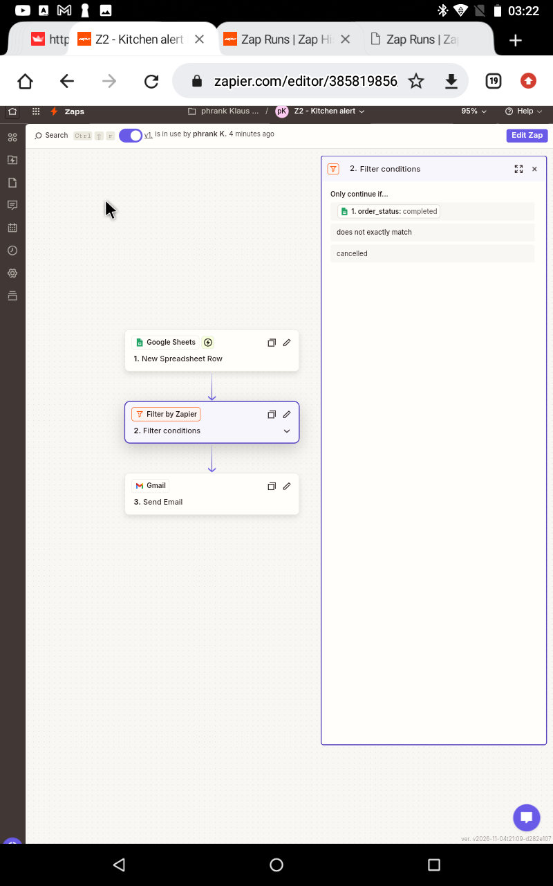
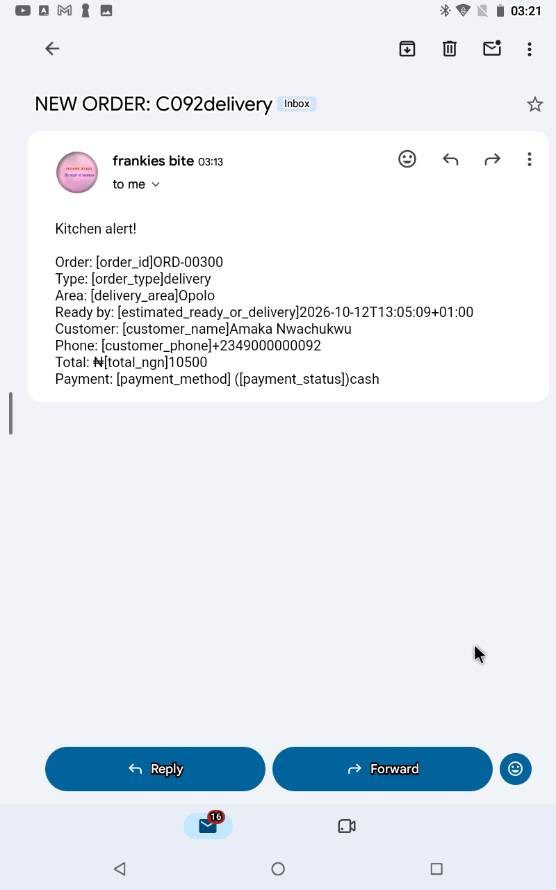

# Zap 2: Kitchen Alert (skips cancelled orders)

**Goal:** Alert the kitchen when a new order arrives, but ignore cancelled orders.

**Trigger:** Google Sheets, New Spreadsheet Row (`orders` tab)
**Filter:** Continue only if `order_status` does not exactly match `cancelled`
**Action:** Gmail, Send Email. The subject and body use the order data (order ID, type, area, ready-by time, customer, phone, total, payment). Sent to a test address.

## Test
- A `completed` row sent the kitchen email (Success in Zap History).
- A `cancelled` row did not send an email (Filtered in Zap History).

## Problems I hit
- An empty Step 4 placeholder was left on the canvas. I deleted it before publishing.

## What I'd improve
- The alert doesn't list the ordered items, because they live in the `order_items` tab. I'd add a lookup step to pull them in.
- Send the alert to a real kitchen channel (Slack or Telegram) instead of email.
- Format the ready-by timestamp so it reads clearly.

## Screenshots

