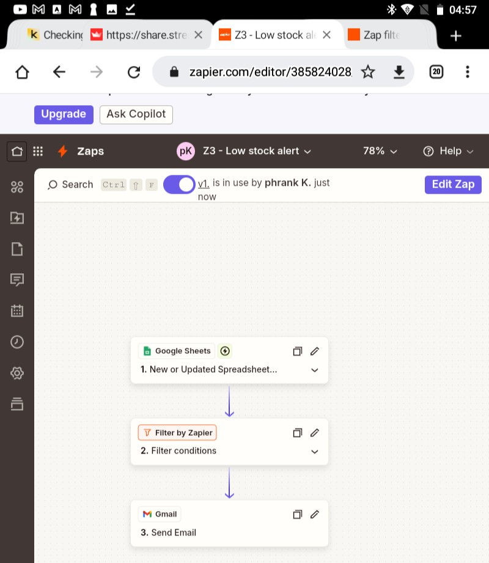
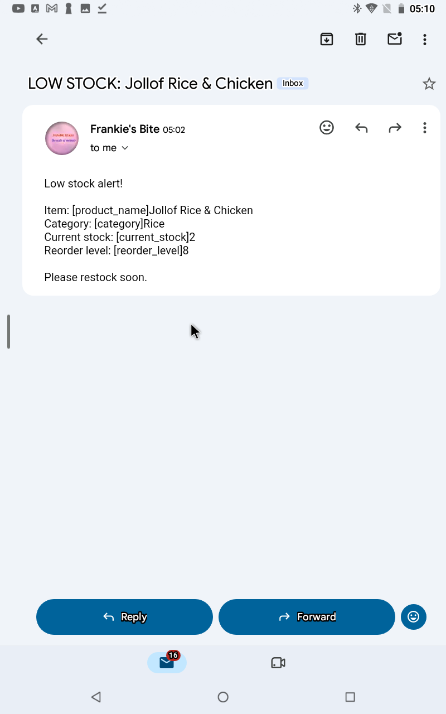
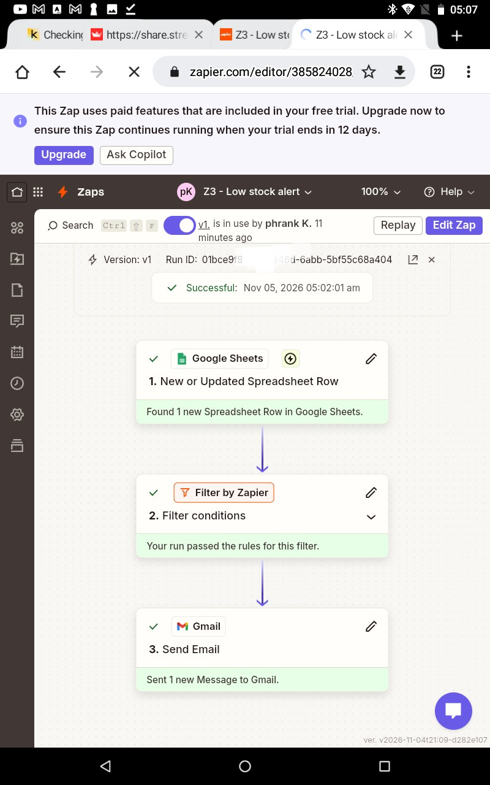
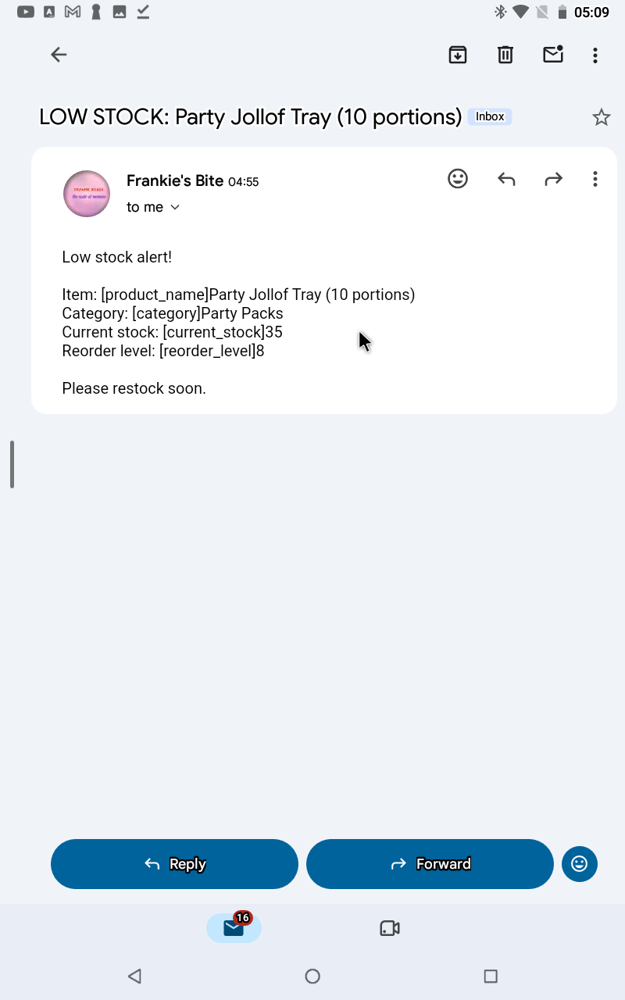

# Zap 3: Low-Stock Alert

| | |
|---|---|
| **Business** | Frankie's Bite (synthetic data), Yenagoa |
| **Tools** | Zapier, Google Sheets, Gmail |
| **Trigger** | Google Sheets, Updated Spreadsheet Row (`menu` tab, `stock_status` column) |
| **Filter** | Continue only if `stock_status` exactly matches `LOW` |
| **Action** | Gmail, Send Email |
| **Status** | Published and tested |

## The problem
Menu items run out without warning, so customers order food the kitchen can't make.

## The solution
A formula in the sheet sets `stock_status` to LOW when `current_stock` falls to or below `reorder_level`. The Zap watches that column and emails the manager when an item flips to LOW.

## Test
- Set an item's stock to 2: it flipped to LOW and the alert email arrived.
- Set it back to 30: it flipped to OK and Zap History showed Filtered.

## What went wrong, and how I fixed it
- `stock_status` was plain text, so it never changed when stock changed. I replaced it with a formula.
- The filter test said "Your zap would not have continued", because the sample row was OK. That was the filter working correctly, so I confirmed it with a real stock change.

## What I learned
- "Updated Row" triggers fire on changes, while "New Row" triggers fire on additions.
- Setting a trigger column avoids unnecessary runs.
- A test sample can be blocked by a filter, so a live test is the real proof.

## Next improvements
- Also add each LOW item to a "reorder list" tab.
- Send the alert to the manager's real email or a Slack/Telegram channel.
- Avoid repeat alerts for an item that stays LOW.

## Screenshots

