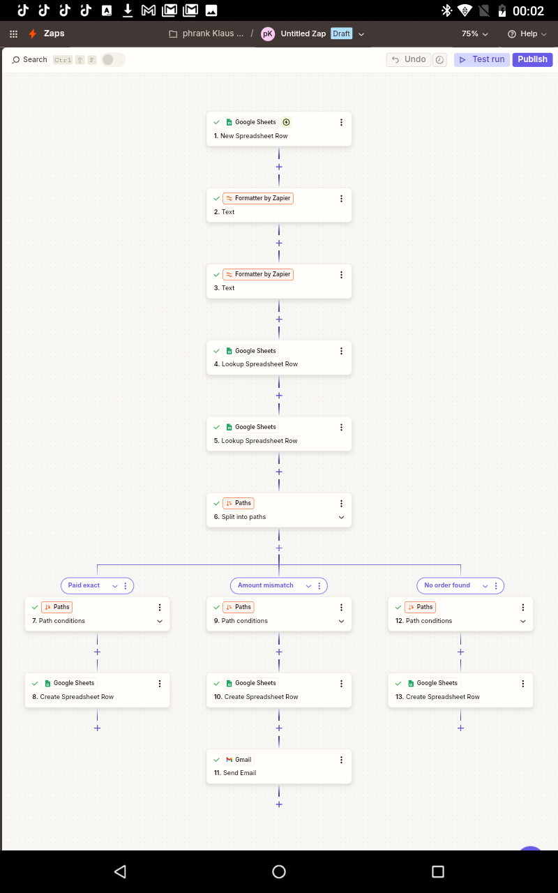
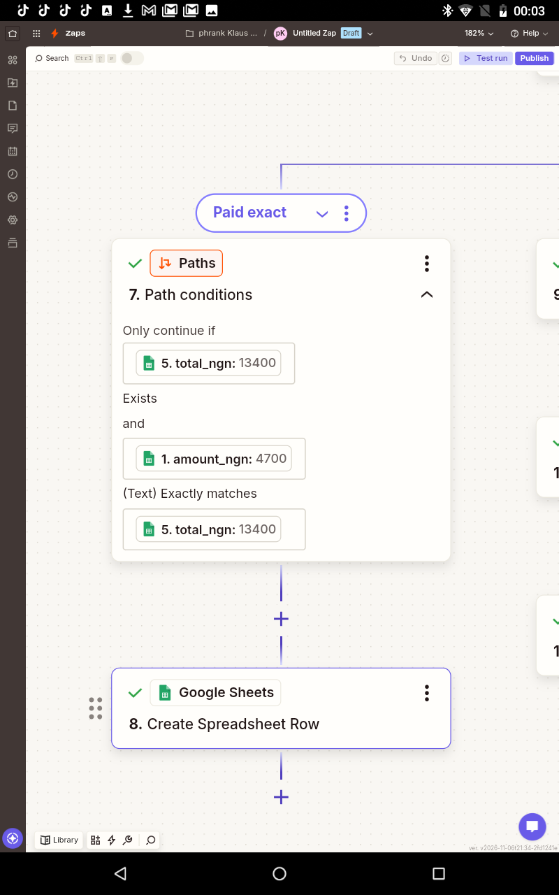
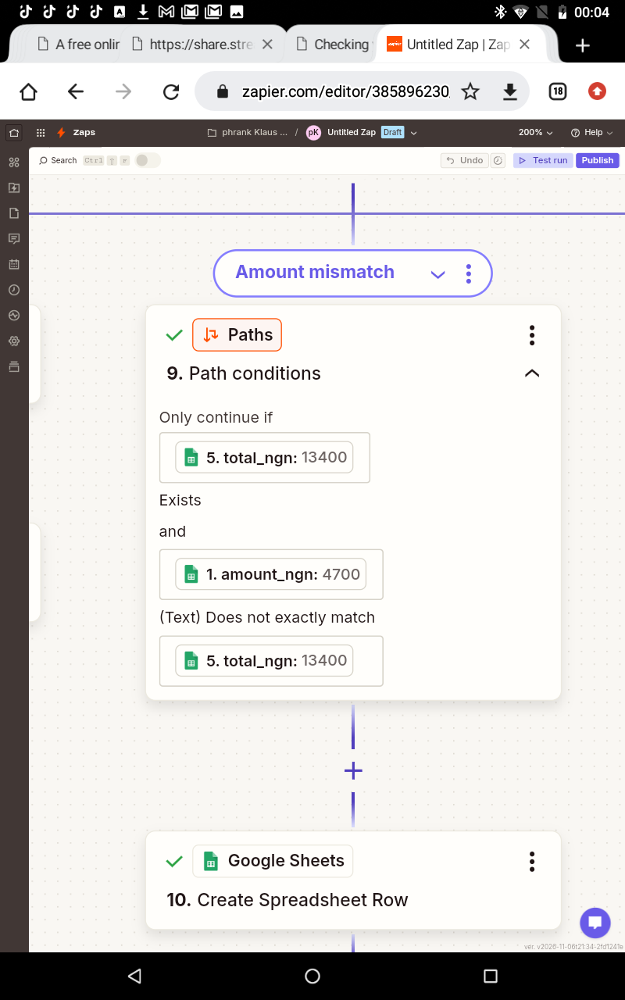
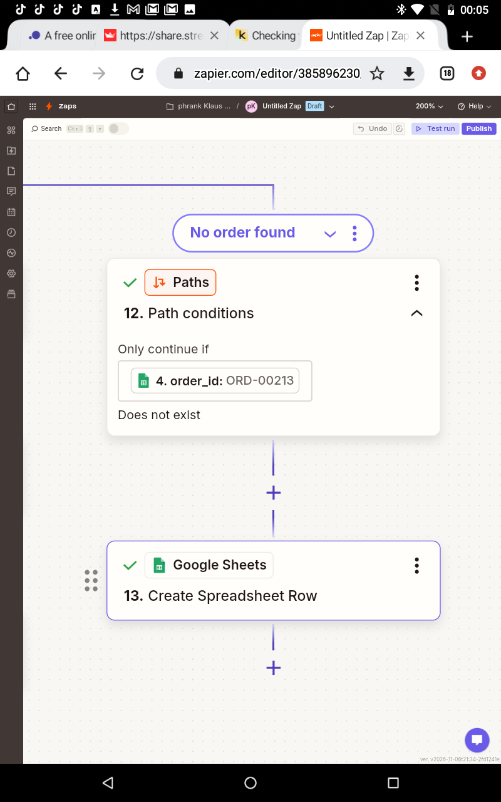
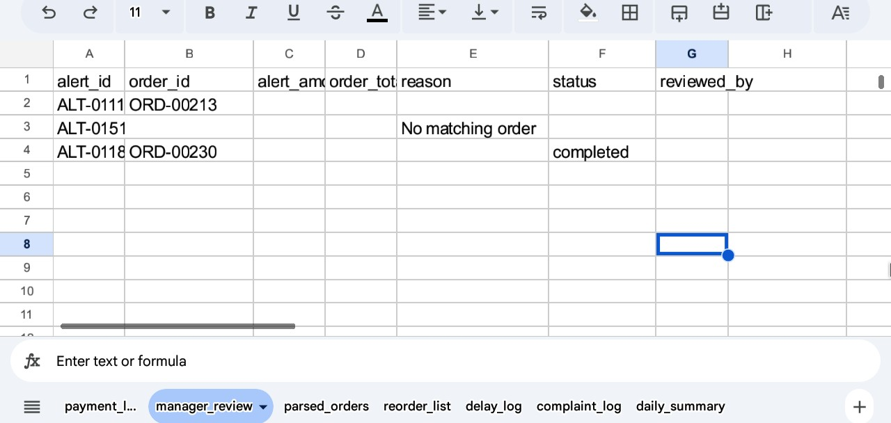
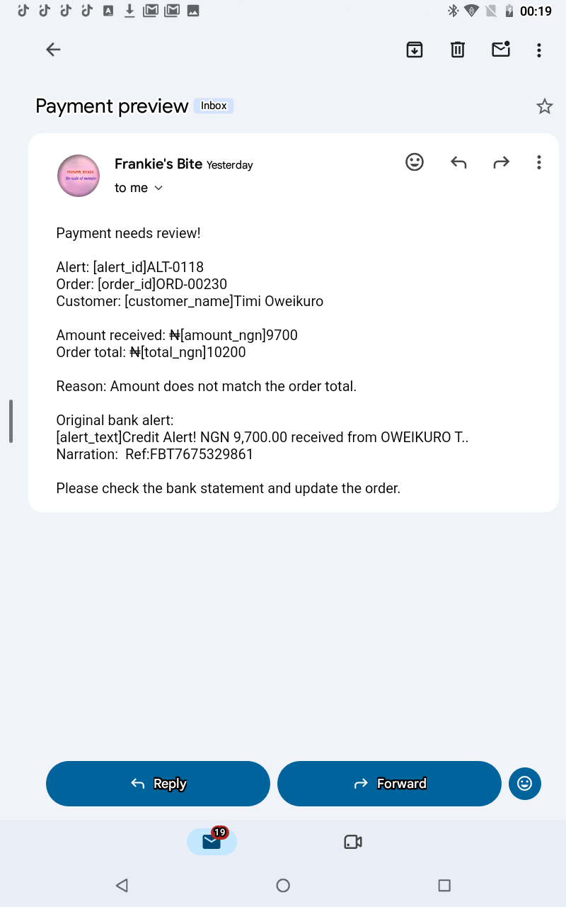
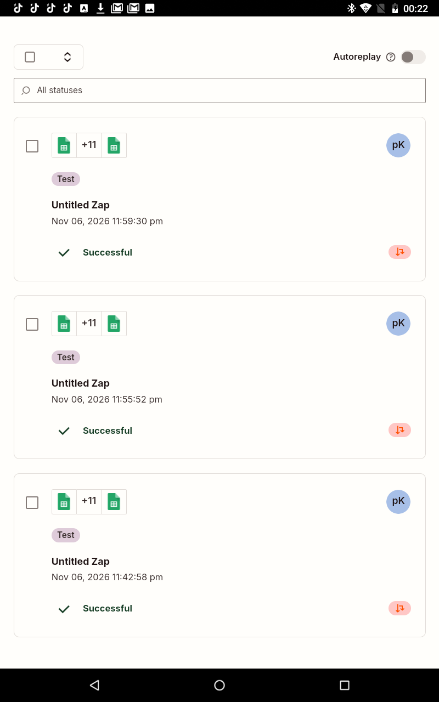

# Zap 4: Payment Matching (bank alert → order)

| | |
|---|---|
| **Business** | Frankie's Bite (synthetic data), Yenagoa |
| **Tools** | Zapier, Google Sheets, Formatter, Paths, Gmail |
| **Trigger** | Google Sheets, New Spreadsheet Row (`bank_alerts` tab) |
| **Logic** | Extract order ID and reference, look up the payment and order, compare amounts, then route with Paths |
| **Status** | Tested with 3 alerts |

## The problem
Staff match bank transfer alerts to orders by hand. It is slow, and underpaid or unknown transfers are easy to miss.

## The solution
When a new bank alert row is added, the Zap:
1. Extracts the order ID (`ORD-\d{5}`) and the bank reference (`FBT\d+`) from the alert text with Formatter.
2. Looks up the reference in the `payments` tab to find the order, then looks up the order in `orders`.
3. Splits into three paths:
   - **Paid exact:** the amount equals the order total, so a row is added to `payment_log`.
   - **Amount mismatch:** the amount differs, so a row goes to `manager_review` and the manager gets an email.
   - **No order found:** no matching order, so a row goes to `manager_review`.

Only 10 of the 60 alerts contain a full order ID in the text, so I matched on the bank reference instead, which works for nearly every alert.

## Test
| Alert | What it was | Path taken |
|---|---|---|
| ALT-0015 | Exact payment (₦4,700) | Paid exact |
| ALT-0118 | Underpaid (₦9,700 vs ₦10,200) | Amount mismatch |
| ALT-0151 | Reference not in `payments` | No order found |

## Results
All 3 test alerts went down the expected path. Over the full 60 alerts, my answer key expects 52 paid exactly, 4 underpaid, 1 overpaid and 3 unmatched.

## What went wrong, and how I fixed it
- I first imported the helper tabs into a separate spreadsheet, so Zapier could not find `manager_review`. I moved the tabs into the main spreadsheet and repointed the three Create Row steps.
- Unmatched alerts have no order, so lookups could stop the Zap. I set the lookups to continue when nothing is found, so those alerts reach the "No order found" path.

## What I learned
- Real bank alerts are messy, so matching needs a fallback key (the bank reference), not only the order ID.
- Paths turn one trigger into different outcomes, and unmatched cases need a human.
- Compare amounts as numbers, not text.

## Next improvements
- Mark the order as paid in the `orders` tab on the exact path.
- Handle duplicate alerts with Storage by Zapier, so one transfer is never counted twice.
- Add an overpayment path with its own wording.
- Alert a real manager channel (Slack or Telegram) instead of a test email.

## Screenshots

