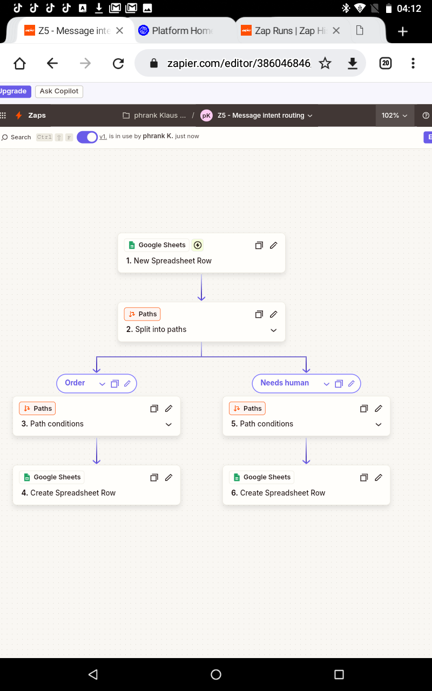
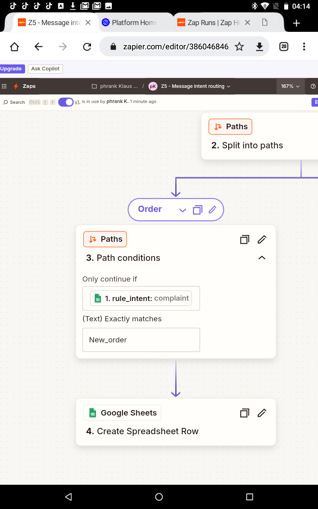
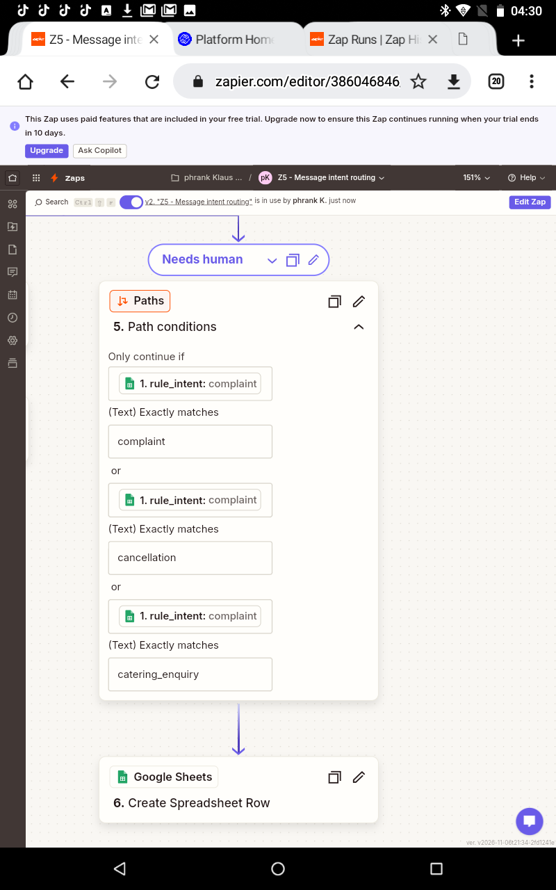
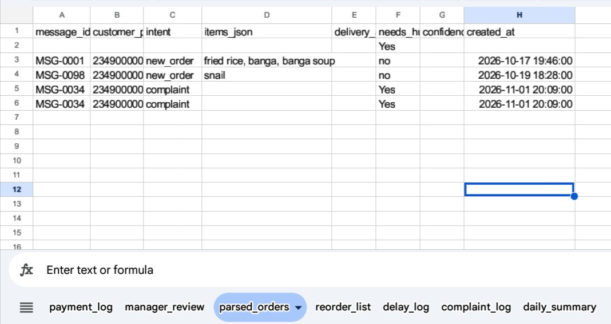
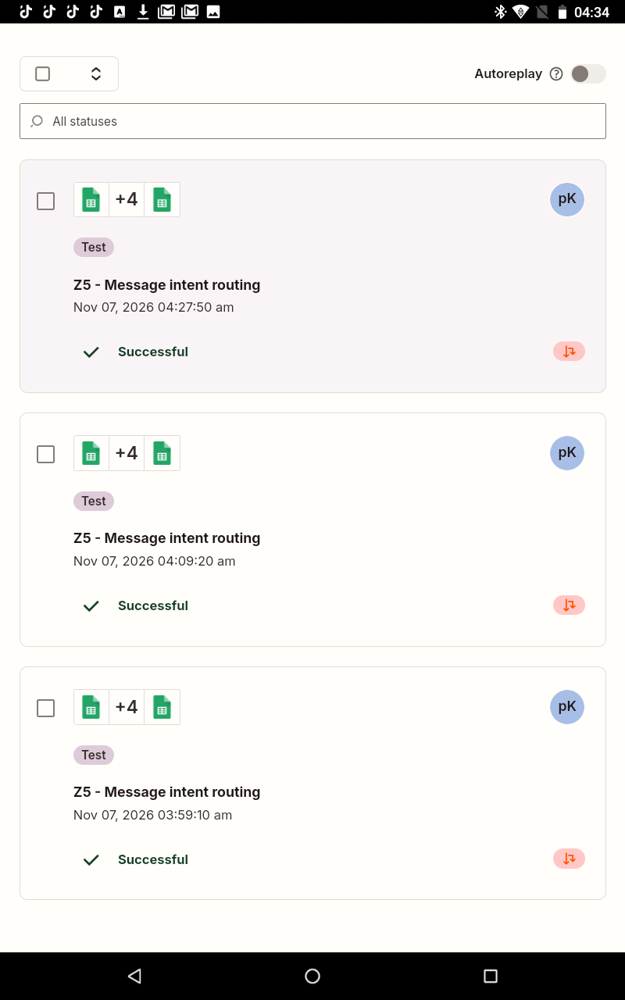
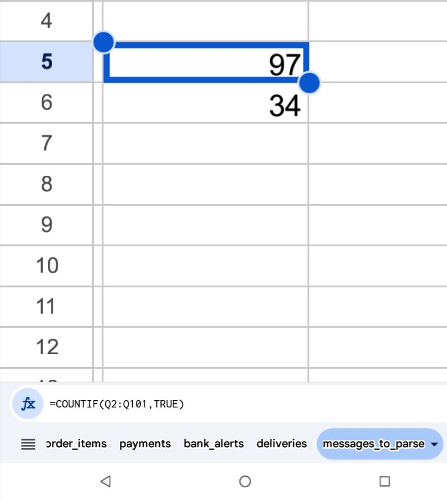

# Zap 5: Message Intent Routing (rules, no paid AI)

## The problem
Customers send orders and questions as messy WhatsApp text. Staff read each one by hand.

## The solution
Google Sheets formulas classify each message by keywords (12 intents) and match food nicknames from the menu_aliases tab. A Zap routes the result with Paths: clear orders go to parsed_orders, and complaints, cancellations, catering requests, incomplete orders and unmatched messages go to a human.

## Results
- Rule engine matched 97 of 100 test messages.
- Test run: 1 order and 1 complaint were routed correctly, and a price question was ignored.

## Limitations
- The rules were tuned on the same 100 messages, so 97/100 is optimistic.
- The 3 misses had typos ("hvae", "youh ave", "de?y") and fell to "needs human", which is a safe failure.
- Rules can't read messy Pidgin or context as well as an AI model. A hybrid (rules first, AI for unclear messages) is the next step.
- I avoided a paid AI step because I'm on free plans.

## What I learned
- Put cheap, testable logic before AI.
- Make failures safe: unknown means a human.
- Mutually exclusive path rules prevent double processing.

## Screenshots

