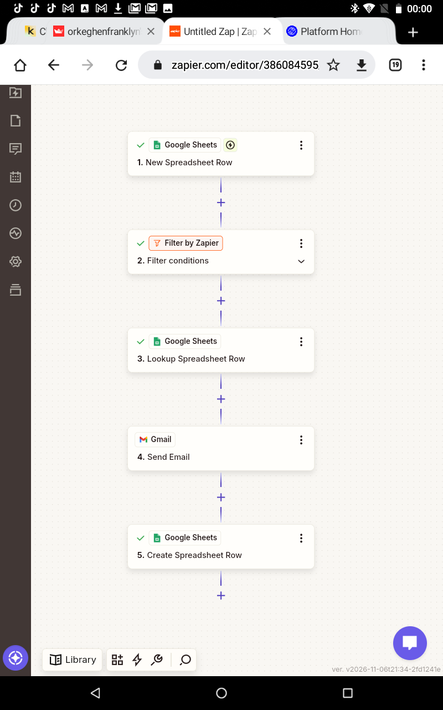
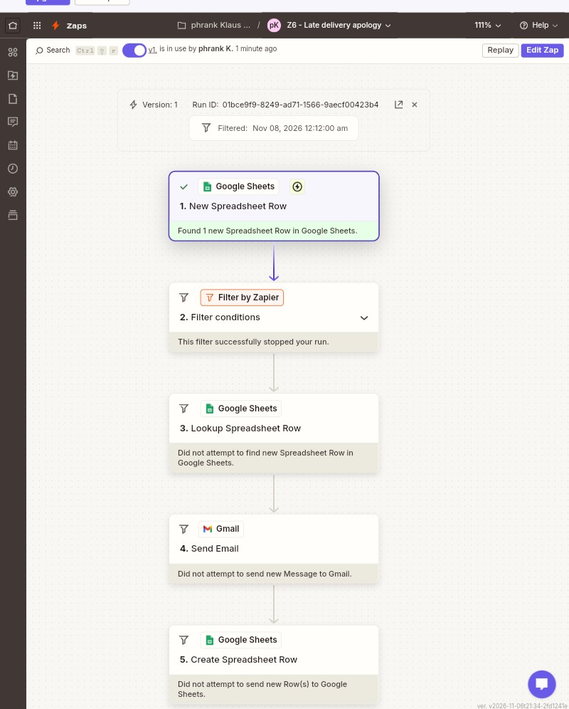
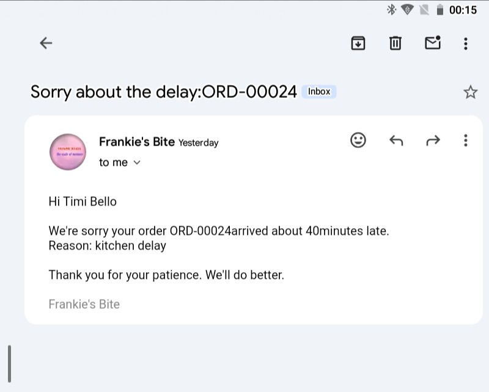
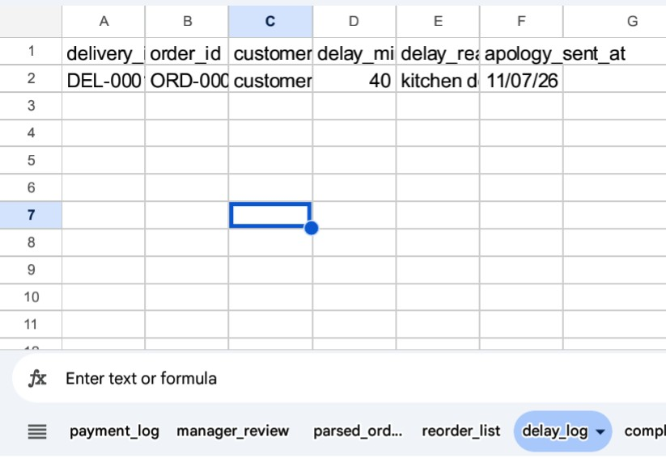
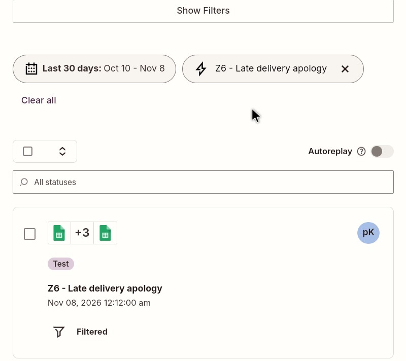

# Zap 6: Late-Delivery Apology

| | |
|---|---|
| **Business** | Frankie's Bite (synthetic data), Yenagoa |
| **Tools** | Zapier, Google Sheets, Filter, Gmail |
| **Trigger** | Google Sheets, New Spreadsheet Row (`deliveries` tab) |
| **Filter** | Continue only if `delivery_status` exactly matches `delayed` |
| **Status** | Published and tested |

## The problem
When a delivery runs late, customers get no apology, and the business has no record of how often it happens or why.

## The solution
When a new delivery row is added, the Zap:
1. Filters out everything except delayed deliveries (22 of 211 in the data).
2. Looks up the order in the `orders` tab to get the customer's name and email.
3. Sends an apology email with the order ID, the minutes late and the reason.
4. Logs each apology in a `delay_log` tab with a timestamp.

Test emails went to my own address, because the sample customer emails use example.com.

## Test
- A delayed delivery (DEL-00019) found the right customer (Timi Bello), sent the email and added a log row.
- A delivered record (DEL-00002) was stopped by the filter and showed as Filtered.

## What went wrong, and how I fixed it
- The `apology_sent_at` column first showed the words "Zap Meta Human Now" as plain text. I had typed it. I re-inserted it from the data picker and it produced a real timestamp. I deleted the bad test row.
- An empty extra step was left on the canvas and blocked publishing. I deleted it.

## What I learned
- A field must be inserted from the picker, not typed, or the sheet gets the label as text.
- Each test run writes real rows, so I tested each record once and cleaned up afterwards.
- A lookup joins two tabs, so the delivery row didn't need customer details.

## Next improvements
- Handle failed deliveries (8 in the data) with an alert to the manager, not an apology.
- Offer a discount code for deliveries more than 30 minutes late.
- Send to the real customer email in production.
- Flag riders or reasons that cause repeated delays.

## Screenshots

