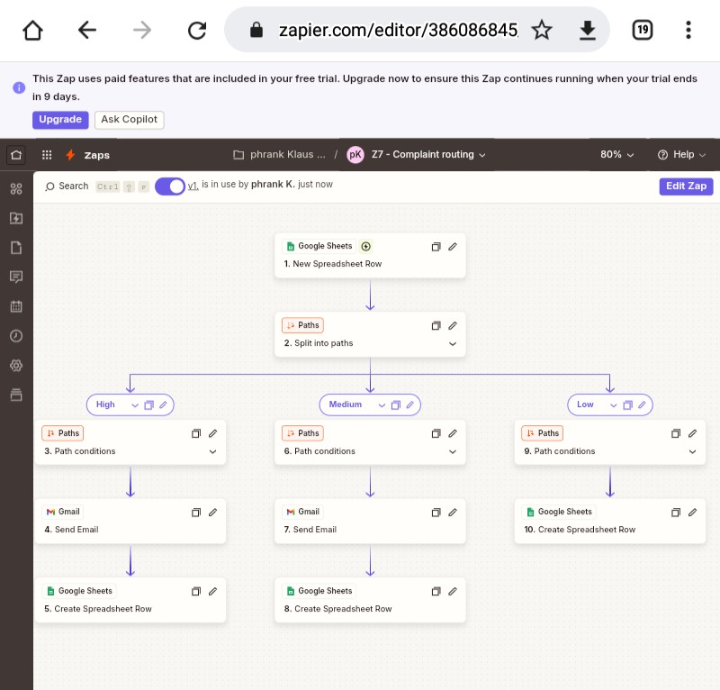
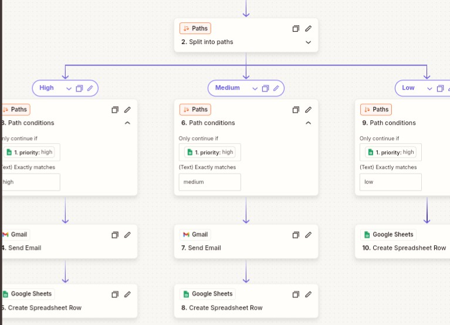
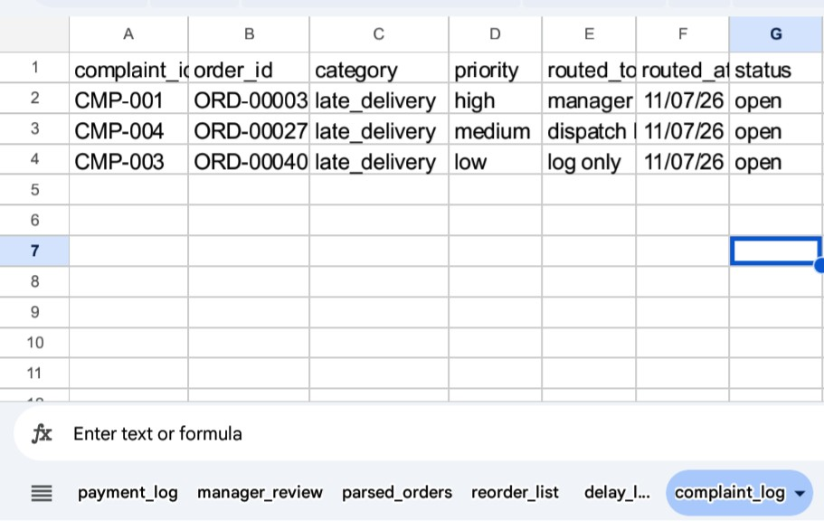
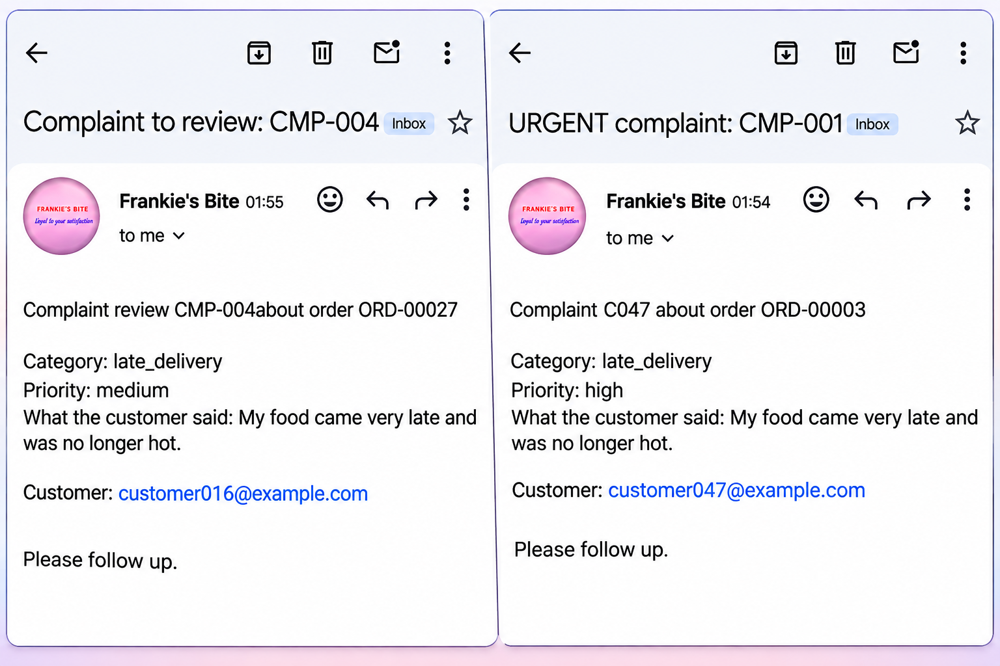
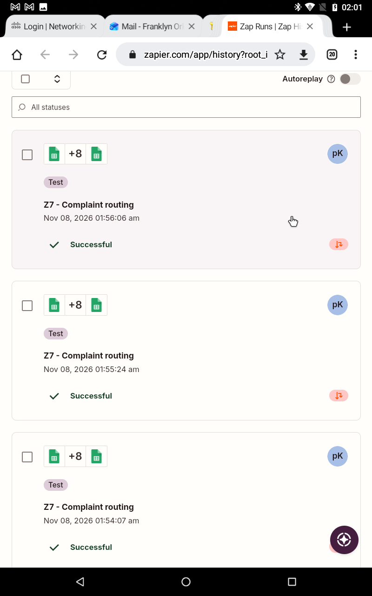

# Zap 7: Complaint Routing by Priority

| | |
|---|---|
| **Business** | Frankie's Bite (synthetic data), Yenagoa |
| **Tools** | Zapier, Google Sheets, Paths, Gmail |
| **Trigger** | Google Sheets, New Spreadsheet Row (`complaints` tab) |
| **Status** | Published and tested |

## The problem
Complaints pile up with no consistent follow-up, and urgent ones can wait as long as minor ones.

## The solution
A Zap reads each new complaint's priority and routes it with Paths:
- **High:** urgent email to the manager and a log row.
- **Medium:** review email to the dispatch lead and a log row.
- **Low:** log row only, with no email.
Every complaint is recorded in a `complaint_log` tab with a timestamp.

## Test
One complaint per priority (CMP-001, CMP-004, CMP-003) went to the right path: 3 log rows and 2 emails.
The data has 30 complaints: 5 high, 12 medium and 13 low.

## What went wrong, and how I fixed it
Routing date and time was inaccurate, so i used the variable option in zapier to produce accurate date and time.

## What I learned
- Exact lowercase values matter in path rules.
- Not every case needs a person. Low-priority items are logged only, which saves staff time.
- Each path writes its own log row, so the log shows how every complaint was handled.

## Next improvements
- Message the customer an acknowledgement.
- Escalate a medium complaint to high if it stays open too long.
- Send urgent alerts to Slack or Telegram instead of email.
- Weekly report of complaints by category.

## Screenshots

