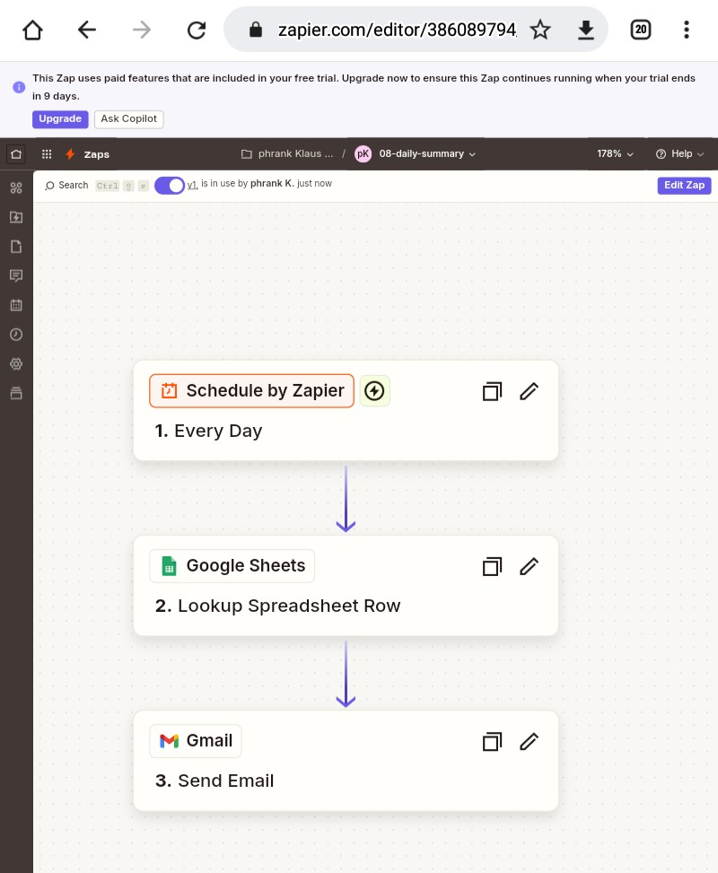
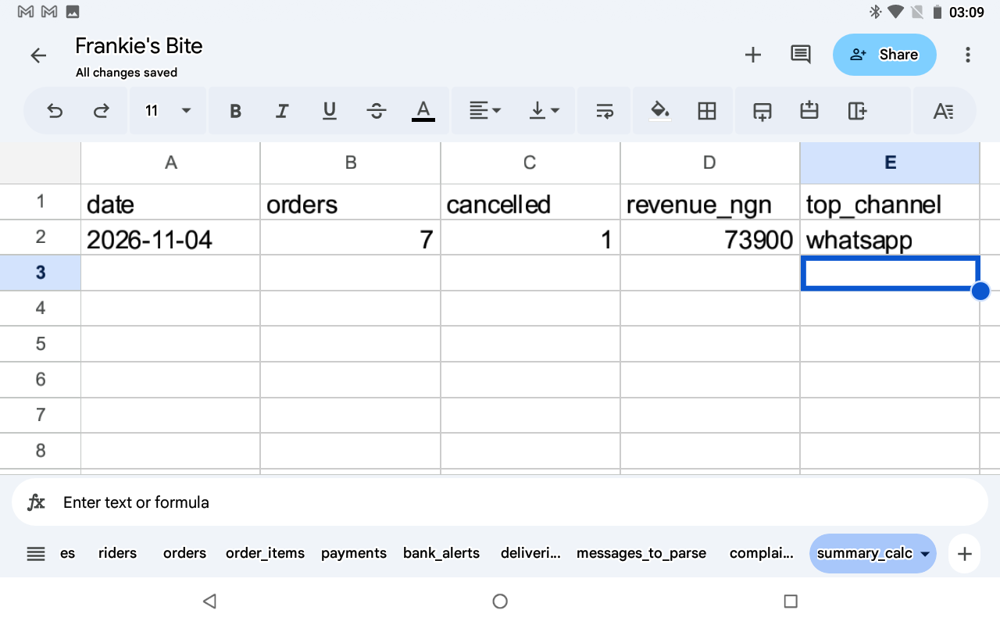
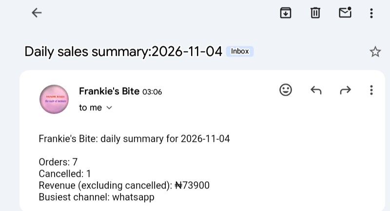
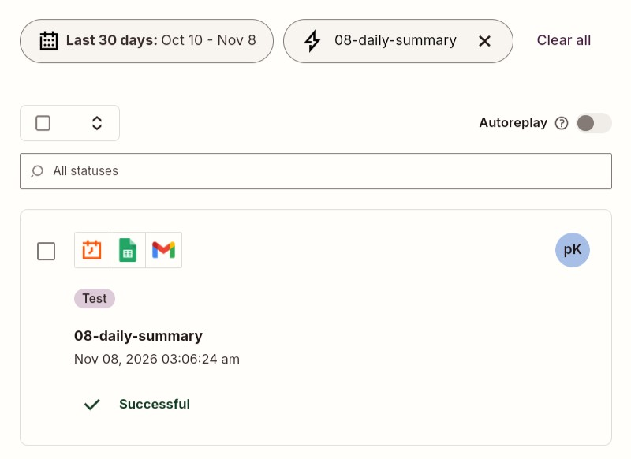

# Zap 8: Daily Sales Summary

| | |
|---|---|
| **Business** | Frankie's Bite (synthetic data), Yenagoa |
| **Tools** | Zapier (Schedule), Google Sheets formulas, Gmail |
| **Trigger** | Schedule by Zapier, every day at 9 PM |
| **Status** | Tested |

## The problem
The owner has no quick view of the day: orders, cancellations, revenue and which channel is busiest.

## The solution
Google Sheets formulas in a `summary_calc` tab count the day's orders, cancelled orders and revenue (excluding cancelled), and find the busiest channel. A scheduled Zap looks up that row and emails the summary.

I split the work on purpose: the sheet does the counting and Zapier does the scheduling and sending. It is free, easy to check and easy to change.

## Test
For 4 Nov 2026 the email showed 7 orders, 1 cancelled, ₦73,900 revenue and WhatsApp as the busiest channel. These match an independent check with a Python script.

## What went wrong, and how I fixed it
(Write your own. For example: the date had to be stored as text, so I used an apostrophe.)

## Limitations
- The data ends on 4 Nov 2026, so I typed a fixed test date. In production, a Formatter step would insert yesterday's date.
- "Top item" is left out because it needs a heavier formula.
- A daily Zap uses free-plan tasks every day, so I turned it off after testing.

## What I learned
- Put counting in the sheet and routing in Zapier.
- Verify results with a second method (Python) before trusting them.
- Dates stored as text need exact matching.

## Next improvements
- Insert yesterday's date automatically.
- Add the top-selling item.
- Send the summary to Telegram or WhatsApp.
- Weekly and monthly versions.

## Screenshots

